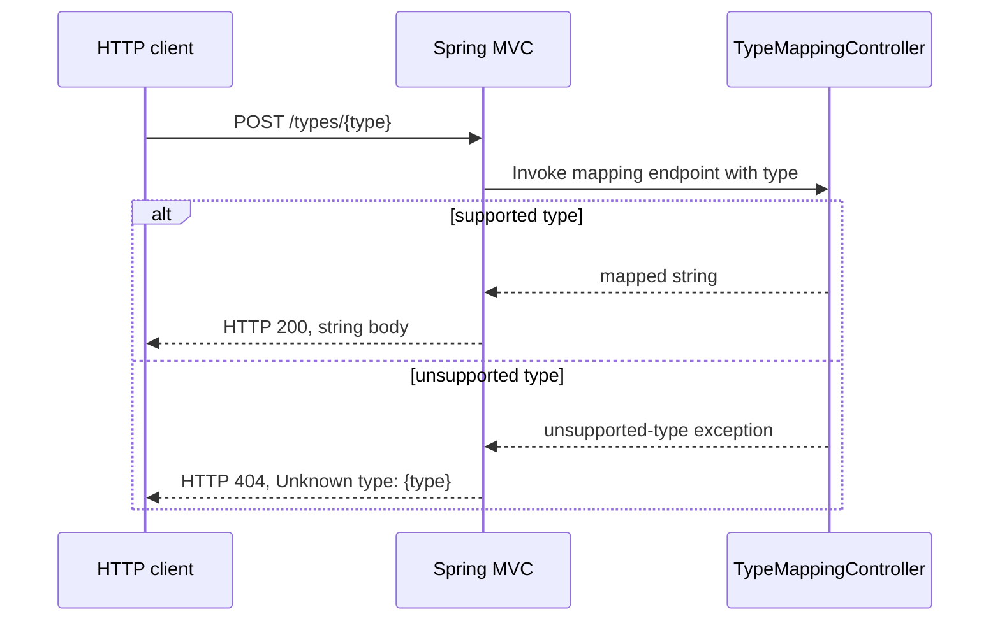

# Component Dependencies

## Dependency Matrix

| Component | Depends on | Relationship |
|---|---|---|
| `TypeMappingController` | Spring Web / Spring MVC | Route binding and exception handling |
| `TypeMappingController` | None | Mapping logic is local and stateless |

## Communication Pattern
The HTTP client communicates with the controller through Spring MVC. There are no inter-component or downstream service calls.

## Data Flow

Text alternative: Spring MVC dispatches the POST route to `TypeMappingController`. Supported values yield HTTP 200 and a mapped string; unsupported values are translated to HTTP 404 with the supplied value in the error body.
