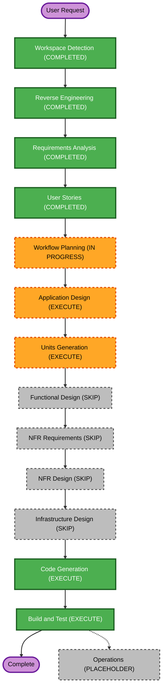

# Execution Plan

## Detailed Analysis Summary

### Transformation Scope
- **Transformation Type**: Single-component application change.
- **Primary Changes**: Add a new REST controller for the type mapping endpoint; add live-server integration tests and the required test/build configuration.
- **Related Components**: Existing Spring Boot application, Maven build, and the existing home endpoint as a regression check.

### Change Impact Assessment
- **User-facing changes**: Yes - API consumers gain a new POST endpoint.
- **Structural changes**: Yes - one new controller and integration-test code.
- **Data model changes**: No.
- **API changes**: Yes - add `POST /types/{type}`.
- **NFR impact**: No additional performance, availability, or operational targets. The API is explicitly unauthenticated; no security extension or infrastructure change was requested.

### Component Relationships
- **Primary Component**: Single Maven Spring Boot application.
- **Infrastructure Components**: None identified.
- **Shared Components**: None.
- **Dependent Components**: None identified in the repository.
- **Supporting Components**: Maven integration-test configuration and test dependencies.

### Risk Assessment
- **Risk Level**: Low - isolated endpoint and no data or infrastructure changes.
- **Rollback Complexity**: Easy - remove the new controller/test configuration.
- **Testing Complexity**: Moderate - a live embedded-server integration test is required; the project currently has no test dependencies or test sources.

## Workflow Visualization

Text alternative: Workspace Detection, Reverse Engineering, Requirements Analysis, and User Stories are complete. After approval, execute Application Design, Units Generation (one unit), Code Generation, and Build and Test. Skip Functional Design, NFR Requirements, NFR Design, and Infrastructure Design for the reasons below. Operations is a placeholder.

## Phases to Execute

### INCEPTION PHASE
- [x] Workspace Detection (COMPLETED)
- [x] Reverse Engineering (COMPLETED)
- [x] Requirements Analysis (COMPLETED)
- [x] User Stories (COMPLETED)
- [ ] Workflow Planning (IN PROGRESS)
- [ ] Application Design - EXECUTE
  - **Rationale**: A new controller and method contract are needed for the API.
- [ ] Units Generation - EXECUTE (one unit)
  - **Rationale**: The workflow classifies API changes/new endpoints as a trigger. The implementation is one small unit in the existing application; no multi-unit decomposition is expected.

### CONSTRUCTION PHASE
- [ ] Functional Design - SKIP
  - **Rationale**: The mapping is simple, fully specified, and has no new domain model or complex business rules.
- [ ] NFR Requirements - SKIP
  - **Rationale**: The user specified no additional performance, availability, or operational targets and explicitly chose no authentication.
- [ ] NFR Design - SKIP
  - **Rationale**: NFR Requirements is skipped and no NFR patterns or logical components are required.
- [ ] Infrastructure Design - SKIP
  - **Rationale**: No deployment or infrastructure changes are needed.
- [ ] Code Generation - EXECUTE (ALWAYS)
  - **Rationale**: Implement the new controller, integration test, and necessary test/build configuration.
- [ ] Build and Test - EXECUTE (ALWAYS)
  - **Rationale**: Build the Maven project and execute the live-server integration test.

### OPERATIONS PHASE
- [ ] Operations - PLACEHOLDER
  - **Rationale**: Future deployment and monitoring workflows are outside this feature's scope.

## Package Change Sequence
- **Update Approach**: Single Maven module; no cross-package sequencing required.
- **Critical Path**: Application Design and Units Generation precede code generation.
- **Coordination Points**: Controller route and response contract must match approved requirements.
- **Testing Checkpoints**: Build and execute the integration test after code generation.

## Estimated Timeline
- **Total Future Stages**: 4
- **Estimated Duration**: Small, single-module change; duration depends on implementation and test execution.

## Success Criteria
- **Primary Goal**: Implement the approved POST type-mapping API.
- **Key Deliverables**: New controller, live-server integration test, and required Maven test configuration.
- **Quality Gates**: Preserve `GET /home`; verify all four mapping results, case-insensitive input, and unsupported-type response through integration tests.
