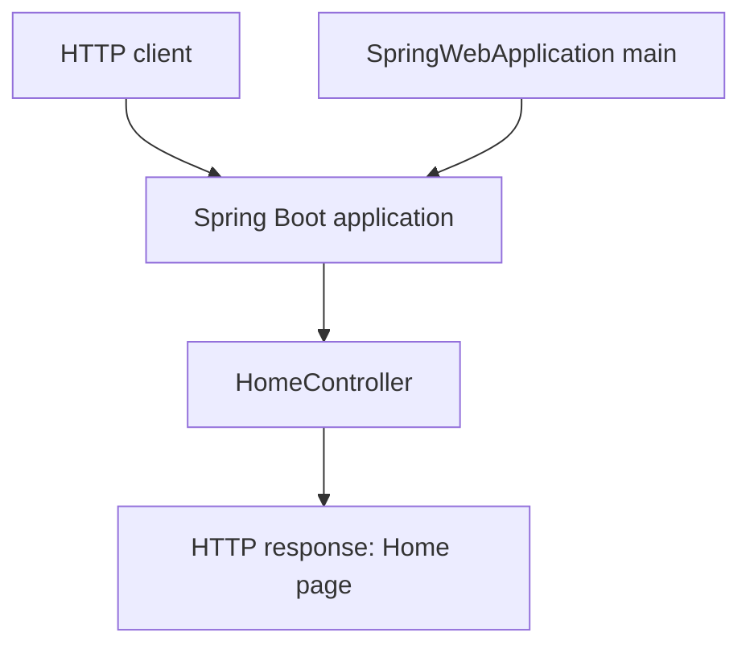
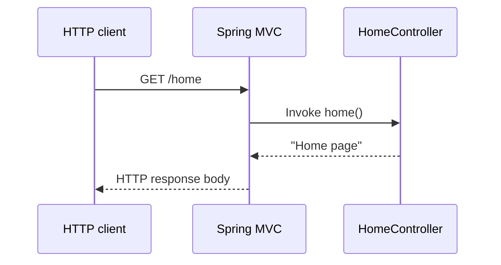

# System Architecture

## System Overview
The workspace contains one Maven-based Spring Boot web application. Spring Boot starts the application; Spring MVC discovers `HomeController` and routes `GET /home` to its `home()` method. No persistence, external integrations, or deployment infrastructure are present in the inspected project files.

## Architecture Diagram

Text alternative: `SpringWebApplication.main` starts the Spring Boot application. An HTTP client request is routed by Spring MVC to `HomeController`, which returns the existing home response.

## Component Descriptions
### SpringWebApplication
- **Purpose**: Application entry point.
- **Responsibilities**: Start Spring Boot.
- **Dependencies**: Spring Boot.
- **Type**: Application bootstrap.

### HomeController
- **Purpose**: Serve the existing home endpoint.
- **Responsibilities**: Handle `GET /home` and return `Home page`.
- **Dependencies**: Spring Web annotations and Spring MVC runtime.
- **Type**: Application/API.

## Data Flow

Text alternative: The existing home request is dispatched to `HomeController.home()`, whose string return value becomes the response body. There is no data store or downstream service in this flow.

## Integration Points
- **External APIs**: None identified.
- **Databases**: None identified.
- **Third-party Services**: None identified.

## Infrastructure Components
- **CDK Stacks**: None identified.
- **Deployment Model**: Not specified in the repository.
- **Networking**: No network topology or infrastructure configuration found.
