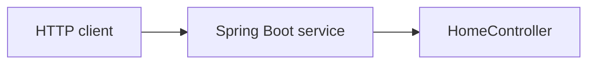

# Business Overview

## Business Context Diagram

Text alternative: An HTTP client calls the Spring Boot service, which currently handles the `/home` request in `HomeController`.

## Business Description
- **Business Description**: The repository contains a minimal web service. Its only implemented business-facing behavior is returning a static home-page string.
- **Business Transactions**:
  - `GET /home`: Returns the literal string `Home page`.
  - **Requested, not yet implemented**: A POST API that accepts a `type` path variable and returns a mapped string. The mapping table is documented in `docs/requirements/feature.md`; the meaning of its separate "Add Info" values is not yet established.
- **Business Dictionary**:
  - **type**: The path-variable name specified for the requested API.
  - **Mapping Result**: The value the requirement says to return for each listed type.
  - **Add Info**: An additional column in the requirement whose effect on the response is unspecified.

## Component-Level Business Descriptions
### AI-DLC-sample application
- **Purpose**: Expose a minimal HTTP service.
- **Responsibilities**: Start the Spring Boot application and return a static response from the existing home endpoint.
