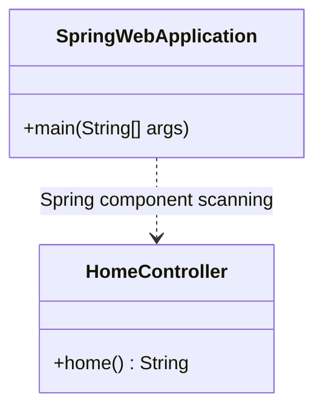

# Code Structure

## Build System
- **Type**: Maven
- **Configuration**: `pom.xml` declares Java source and target 17, Spring Boot Web starter 4.1.1, and Spring Boot Maven plugin 4.1.0.
- **Source Layout**: `src/main/java/org/example/`

## Key Classes/Modules

Text alternative: `SpringWebApplication` is the executable entry point. Spring component scanning discovers the `HomeController` REST controller.

### Existing Files Inventory
- `pom.xml` - Maven project and Spring Boot dependency configuration.
- `src/main/java/org/example/SpringWebApplication.java` - Spring Boot application entry point.
- `src/main/java/org/example/HomeController.java` - Existing `GET /home` REST endpoint.

## Design Patterns
### Spring MVC REST Controller
- **Location**: `HomeController.java`
- **Purpose**: Map an HTTP route to a Java method.
- **Implementation**: `@RestController` and `@GetMapping("/home")`.

## Critical Dependencies
### Spring Boot Web Starter
- **Version**: 4.1.1
- **Usage**: Provides Spring web/MVC support for the REST controller.
- **Purpose**: HTTP request routing and web application support.

### Spring Boot Maven Plugin
- **Version**: 4.1.0
- **Usage**: Declared in `pom.xml`.
- **Purpose**: Spring Boot Maven build integration.
