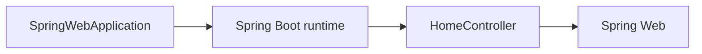

# Dependencies

## Internal Dependencies

Text alternative: The application entry point starts Spring Boot; Spring Boot component scanning registers `HomeController`, which uses Spring Web annotations.

### Application entry point and controller
- **Type**: Runtime framework relationship.
- **Reason**: Spring Boot starts and discovers the REST controller.

## External Dependencies
### `org.springframework.boot:spring-boot-starter-web`
- **Version**: 4.1.1
- **Purpose**: Spring web application and MVC support.
- **License**: Not assessed.

### `org.springframework.boot:spring-boot-maven-plugin`
- **Version**: 4.1.0
- **Purpose**: Maven integration for Spring Boot.
- **License**: Not assessed.
